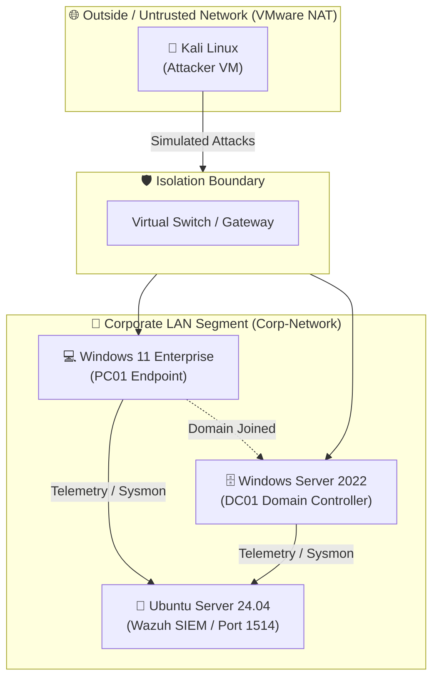

# 🛡️ Enterprise Purple Team Homelab

> **🎯 Project Objective:** 
> To architect, deploy, and manage a fully monitored enterprise network environment to simulate real-world cyber attacks and engineer custom threat detections (Purple Teaming).

## 🗺️ Logical Network Topology



---

## 🏗️ Lab Infrastructure & Architecture

### 1. Hardware & Virtualization Layer
* **Host Machine:** HP OMEN 16 Laptop
  * **Memory:** 64 GB DDR5 RAM
  * **Processor:** Intel Core i7 (14th Gen)
* **Hypervisor:** VMware Workstation Pro
* **Network Segmentation:** 
  * Configured an isolated **VMware LAN Segment (`Corp-Network`)** to simulate an internal enterprise network.
  * Completely air-gapped the victim domain from the host OS and external public internet while maintaining controlled internal log forwarding.

---

### 2. The "Victim" Network (Active Directory Domain)

| Machine Hostname | Operating System | Role / Purpose | IP Assignment |
| :--- | :--- | :--- | :--- |
| **`DC01`** | Windows Server 2022 (Desktop Exp.) | Active Directory Domain Services (Root Forest Domain) | Static |
| **`PC01`** | Windows 11 Enterprise | Corporate Workstation (Domain-Joined Endpoint) | DHCP / Static |

* **Domain Configuration:** Established domain forest (`corp.local`) on `DC01`, providing centralized authentication, group policies, and identity management.
* **Workstation Enrollment:** Bypassed Microsoft Cloud OOBE on `PC01`, provisioned a local administrative baseline, and joined the machine to the Active Directory domain.
* **Telemetry & Sensor Layer:**
  * Deployed **Microsoft Sysmon (System Monitor)** across both `DC01` and `PC01`.
  * Applied the industry-standard **SwiftOnSecurity Sysmon Configuration** (`sysmonconfig-export.xml`) to eliminate background operating system noise while actively tracking:
    * **Event ID 1:** Process Creation (Command-line logging, Parent Process tracking).
    * **Event ID 3:** Network Connections initiated by binaries.
    * **Event ID 11 / 13:** File creation and Registry modification for persistence tracking.

---

### 3. Security Operations Center (SOC) Infrastructure

```text
[ Windows Endpoints ] --(Sysmon EventChannel)--> [ Wazuh Agent ] 
                                                        │
                                          Encrypted TCP/1514
                                                        ▼
                                             [ Wazuh Manager ]
                                          (Ubuntu Server 24.04)
```

* **SIEM Platform:** **Wazuh (Open-Source SIEM / XDR)**
* **Server Host:** Ubuntu Server 24.04 LTS (Headless Deployment)
* **Deployment Topology:** Full All-in-One deployment:
  * **Wazuh Indexer:** High-performance search & indexing engine.
  * **Wazuh Server:** Core analysis engine, decoding logs and matching against MITRE ATT&CK rules.
  * **Wazuh Dashboard:** Centralized analyst interface for real-time threat hunting.
* **Telemetry Pipeline & Custom Data Ingestion:**
  * Deployed **Wazuh Windows Agents** on all endpoints.
  * Customized agent configurations (`ossec.conf`) to bridge raw Sysmon events directly into the SIEM pipeline via the Windows EventChannel API:

```xml
<!-- Custom Sysmon EventChannel Subscription -->
<localfile>
  <location>Microsoft-Windows-Sysmon/Operational</location>
  <log_format>eventchannel</log_format>
</localfile>
```
